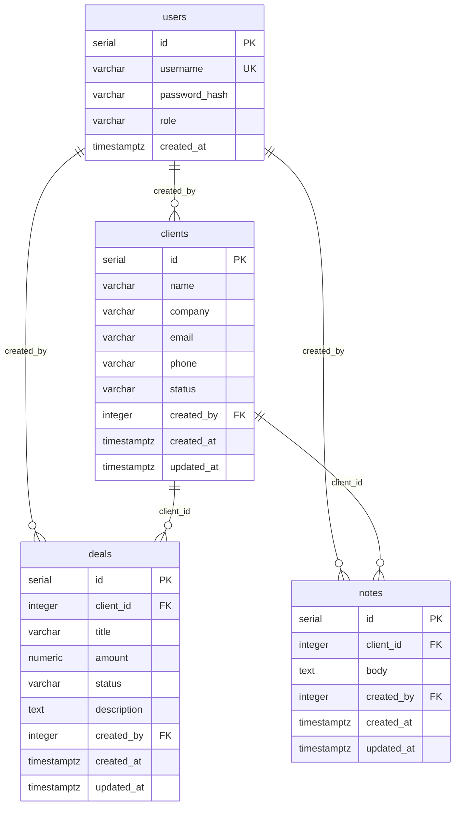

# Мини-CRM для учёта клиентов и сделок

Одностраничное CRM-приложение для небольшой команды продаж: клиентская база, сделки, заметки, воронка по статусам и агрегатный дашборд. Backend — Express, база — PostgreSQL, frontend — Vanilla JS без сборки.

## Возможности

- JWT-аутентификация и две роли: `admin`, `manager`.
- CRUD клиентов, сделок, заметок и пользователей.
- Воронка сделок: `new` → `in_progress` → `won` / `lost`.
- Смена статуса сделки через форму редактирования (только `admin`).
- Фильтрация сделок по статусу.
- Поиск по клиентам и сделкам на сервере через `ILIKE`.
- Дашборд: сумма и количество сделок, разбивка по статусам, количество клиентов.
- Заметки клиента: просмотр, добавление, редактирование, удаление.
- Административная вкладка «Команда» для управления пользователями.
- Адаптивная вёрстка, нативные `<dialog>`, живые уведомления об ошибках.
- Автоматическое создание схемы и демо-пользователей при старте.
- Docker Compose для PostgreSQL.

## Роли

| Действие | `admin` | `manager` |
|---|---:|---:|
| Просмотр клиентов, сделок, дашборда | да | да |
| Поиск и фильтрация | да | да |
| Создание клиента и сделки | да | да |
| Редактирование клиента и сделки | да | нет |
| Смена статуса сделки | да | нет |
| Удаление клиента и сделки | да | нет |
| Просмотр и добавление заметок | да | да |
| Редактирование и удаление заметок | да | нет |
| Управление пользователями | да | нет |

Ограничения проверяются и на клиенте, и на сервере. Скрытая кнопка не является защитой: API возвращает `403` при недостатке прав.

## Стек

- Node.js 18+
- Express 4
- PostgreSQL 15
- `pg`, `bcryptjs`, `jsonwebtoken`
- Vanilla JS, HTML, CSS
- Docker Compose — опционально

React не используется. В ТЗ допускается «React или аналоги»; Vanilla JS выбран как аналог без этапа сборки. Это осознанное решение, а не отсутствующая зависимость.

## Быстрый старт

### 1. PostgreSQL

Из корня проекта:

```bash
docker compose up -d
```

Проверка:

```bash
docker compose ps
```

Параметры по умолчанию:

- host: `localhost`
- port: `5432`
- user: `crm_user`
- password: `crm_password`
- database: `mini_crm`

Если PostgreSQL уже установлен локально, создайте базу и пользователя с этими параметрами либо задайте свои переменные окружения.

### 2. Зависимости и запуск

```bash
npm install
npm start
```

Откройте <http://localhost:3000>.

При первом запуске сервер сам выполняет `CREATE TABLE IF NOT EXISTS` для `users`, `clients`, `deals`, `notes`, создаёт индексы и добавляет демо-пользователей. Отдельные миграции не требуются.

### Демо-доступ

| Логин | Пароль | Роль |
|---|---|---|
| `admin` | `admin123` | администратор |
| `manager` | `manager123` | менеджер |

Пароли демо-пользователей можно переопределить через `ADMIN_PASSWORD` и `MANAGER_PASSWORD` до первого запуска. Для production задайте собственные пароли и `JWT_SECRET`.

### Остановка

```bash
docker compose down
```

Данные сохраняются в named volume `crm_db_data`. Команда `docker compose down -v` удаляет и данные — используйте её только для полного сброса.

## Переменные окружения

| Переменная | По умолчанию | Назначение |
|---|---|---|
| `PORT` | `3000` | HTTP-порт |
| `DB_HOST` | `localhost` | PostgreSQL host |
| `DB_PORT` | `5432` | PostgreSQL port |
| `DB_USER` | `crm_user` | пользователь БД |
| `DB_PASSWORD` | `crm_password` | пароль БД |
| `DB_NAME` | `mini_crm` | имя БД |
| `DB_POOL_MAX` | `10` | размер пула соединений |
| `JWT_SECRET` | dev-значение | секрет подписи JWT |
| `JWT_EXPIRES_IN` | `8h` | срок жизни токена |
| `ADMIN_PASSWORD` | `admin123` | пароль seed-администратора |
| `MANAGER_PASSWORD` | `manager123` | пароль seed-менеджера |

Пример для PowerShell:

```powershell
$env:JWT_SECRET = "replace-with-a-long-random-secret"
$env:ADMIN_PASSWORD = "strong-admin-password"
$env:MANAGER_PASSWORD = "strong-manager-password"
npm start
```

## Схема базы данных

### ER-диаграмма



### Таблицы

#### `users`

| Поле | Тип | Ограничения |
|---|---|---|
| `id` | `SERIAL` | PK |
| `username` | `VARCHAR(60)` | NOT NULL, UNIQUE |
| `password_hash` | `VARCHAR(255)` | NOT NULL, bcrypt |
| `role` | `VARCHAR(20)` | NOT NULL, `admin` / `manager` |
| `created_at` | `TIMESTAMPTZ` | NOT NULL, default `NOW()` |

#### `clients`

| Поле | Тип | Ограничения |
|---|---|---|
| `id` | `SERIAL` | PK |
| `name` | `VARCHAR(160)` | NOT NULL |
| `company` | `VARCHAR(160)` | nullable |
| `email` | `VARCHAR(160)` | nullable, проверка формата |
| `phone` | `VARCHAR(60)` | nullable |
| `status` | `VARCHAR(20)` | `active` / `inactive` / `vip` |
| `created_by` | `INTEGER` | FK → `users.id`, `ON DELETE SET NULL` |
| `created_at` | `TIMESTAMPTZ` | NOT NULL |
| `updated_at` | `TIMESTAMPTZ` | NOT NULL |

#### `deals`

| Поле | Тип | Ограничения |
|---|---|---|
| `id` | `SERIAL` | PK |
| `client_id` | `INTEGER` | NOT NULL, FK → `clients.id`, `ON DELETE CASCADE` |
| `title` | `VARCHAR(200)` | NOT NULL |
| `amount` | `NUMERIC(14,2)` | NOT NULL, `>= 0` |
| `status` | `VARCHAR(20)` | `new` / `in_progress` / `won` / `lost` |
| `description` | `TEXT` | nullable |
| `created_by` | `INTEGER` | FK → `users.id`, `ON DELETE SET NULL` |
| `created_at` | `TIMESTAMPTZ` | NOT NULL |
| `updated_at` | `TIMESTAMPTZ` | NOT NULL |

#### `notes`

| Поле | Тип | Ограничения |
|---|---|---|
| `id` | `SERIAL` | PK |
| `client_id` | `INTEGER` | NOT NULL, FK → `clients.id`, `ON DELETE CASCADE` |
| `body` | `TEXT` | NOT NULL |
| `created_by` | `INTEGER` | FK → `users.id`, `ON DELETE SET NULL` |
| `created_at` | `TIMESTAMPTZ` | NOT NULL |
| `updated_at` | `TIMESTAMPTZ` | NOT NULL |

Индексы: `clients(status)`, `deals(status)`, `deals(client_id)`, `notes(client_id)`.

Удаление клиента каскадно удаляет его сделки и заметки. Удаление пользователя не удаляет его записи — `created_by` становится `NULL`.

## API

Все защищённые маршруты требуют:

```http
Authorization: Bearer <JWT>
Content-Type: application/json
```

Формат ошибки:

```json
{
  "error": {
    "code": "VALIDATION_ERROR",
    "message": "Укажите корректный email"
  }
}
```

### Аутентификация

| Метод | Маршрут | Доступ | Описание |
|---|---|---|---|
| `POST` | `/api/auth/login` | public | логин, возвращает JWT |
| `GET` | `/api/auth/me` | любой авторизованный | текущий пользователь |

Пример:

```bash
curl -X POST http://localhost:3000/api/auth/login \
  -H "Content-Type: application/json" \
  -d '{"username":"admin","password":"admin123"}'
```

### Пользователи

| Метод | Маршрут | Доступ |
|---|---|---|
| `GET` | `/api/users` | admin |
| `POST` | `/api/users` | admin |
| `POST` | `/api/auth/register` | admin, алиас создания |
| `PUT` | `/api/users/:id` | admin |
| `DELETE` | `/api/users/:id` | admin |

Ограничения: нельзя удалить себя, удалить последнего администратора или изменить собственную роль.

### Клиенты

| Метод | Маршрут | Доступ |
|---|---|---|
| `GET` | `/api/clients` | любой авторизованный |
| `GET` | `/api/clients/:id` | любой авторизованный |
| `POST` | `/api/clients` | admin, manager |
| `PUT` | `/api/clients/:id` | admin |
| `DELETE` | `/api/clients/:id` | admin |

Параметры списка:

- `?status=active|inactive|vip`
- `?search=строка` — по имени, компании и email.

### Сделки

| Метод | Маршрут | Доступ |
|---|---|---|
| `GET` | `/api/deals` | любой авторизованный |
| `GET` | `/api/deals/:id` | любой авторизованный |
| `POST` | `/api/deals` | admin, manager |
| `PUT` | `/api/deals/:id` | admin |
| `DELETE` | `/api/deals/:id` | admin |

Параметры списка:

- `?status=new|in_progress|won|lost`
- `?client_id=1`
- `?search=строка` — по названию сделки и имени клиента.

Смена статуса выполняется через `PUT /api/deals/:id` и доступна администратору.

### Заметки

| Метод | Маршрут | Доступ |
|---|---|---|
| `GET` | `/api/clients/:id/notes` | любой авторизованный |
| `POST` | `/api/clients/:id/notes` | admin, manager |
| `PUT` | `/api/notes/:id` | admin |
| `DELETE` | `/api/notes/:id` | admin |

### Дашборд

| Метод | Маршрут | Доступ |
|---|---|---|
| `GET` | `/api/dashboard` | любой авторизованный |

Агрегаты считаются SQL-запросами:

- `COUNT(*)` — количество сделок;
- `COALESCE(SUM(amount), 0)` — сумма;
- `GROUP BY status` — разбивка по воронке;
- `COUNT(*) FILTER (WHERE status = 'vip')` — VIP-клиенты.

## Интерфейс

- Вход по логину и паролю, JWT хранится в `localStorage`, сессия восстанавливается при перезагрузке.
- Дашборд слева: общая сумма, количество сделок и клиентов, воронка по статусам.
- Вкладки «Сделки», «Клиенты», «Команда» (последняя только для администратора).
- Поиск по клиентам и сделкам с debounce 300 мс.
- Фильтры по статусам сделок.
- Создание и редактирование клиентов/сделок в модальных окнах.
- Заметки клиента открываются кнопкой `≡` в строке клиента.
- Администратор видит кнопки редактирования и удаления; менеджер — только создание, просмотр, поиск и заметки.
- Ошибки валидации показываются рядом с формой и в toast-уведомлениях.

## Структура проекта

```text
.
├── lib/
│   └── validation.js      # чистые функции валидации
├── public/
│   └── index.html         # SPA: HTML, CSS, Vanilla JS
├── server.js              # Express, JWT, права, SQL, аудит
├── test.js                # интеграционные тесты
├── unit.test.js           # unit-тесты валидации
├── docker-compose.yml     # PostgreSQL 15
├── package.json
└── README.md
```

## Тесты

```bash
npm test
```

Отдельно:

```bash
npm run test:unit
npm run test:integration
```

- `unit.test.js` — 9 unit-тестов чистых функций: `cleanString`, `parseId`, `parseMoney`, email, валидация логина, регистрации, клиента, сделки и заметки.
- `test.js` — 4 интеграционных сценария:
  1. JWT, `/api/auth/me`, права `admin` / `manager`.
  2. CRUD клиента и сделки, смена статуса, поиск, заметки и запрет редактирования для менеджера.
  3. CRUD пользователей, смена пароля, запрет удаления себя.
  4. Агрегаты дашборда и согласованность `SUM` / `COUNT` / `GROUP BY`.

Интеграционные тесты поднимают сервер на свободном порту, используют PostgreSQL и удаляют созданные тестовые записи. Для запуска нужна доступная база.

## Безопасность и валидация

- Пароли хранятся только в виде bcrypt-хеша.
- JWT подписывается секретом, срок действия по умолчанию 8 часов.
- Все SQL-запросы параметризованы.
- Роли проверяются middleware `requireRole` на каждом изменяющем маршруте.
- Валидация выполняется на клиенте и повторно на сервере.
- Ограничен размер JSON-тела: 100 KB.
- Ошибки БД не раскрывают SQL-детали клиенту.
- Действия логируются в JSON-аудит: вход, отказ в доступе, создание, изменение и удаление.

Для production: задайте стойкий `JWT_SECRET`, смените демо-пароли, включите HTTPS и рассмотрите хранение токена в `HttpOnly` cookie вместо `localStorage`.

## Git-процесс

Работа велась через feature-ветки и pull request-ы:

- [PR #1](https://github.com/Greatcya/mini-crm/pull/1) — валидация и unit-тесты.
- [PR #2](https://github.com/Greatcya/mini-crm/pull/2) — поиск, редактирование, статусы и заметки в UI.
- [PR #3](https://github.com/Greatcya/mini-crm/pull/3) — управление пользователями.

Схема веток:

```text
main
 ├── feature/validation-tests
 ├── feature/ui-crud
 └── feature/team-crud
```

Коммиты содержат законченные изменения, ветки вливаются в `main` через merge commit.

## Лицензия

MIT.
